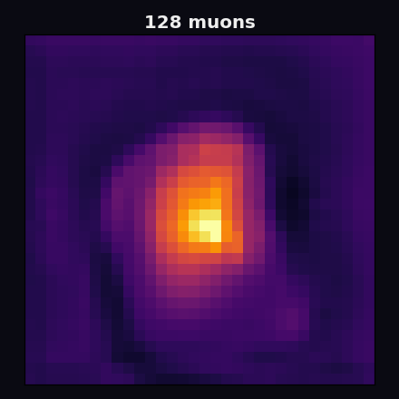

<div align="center">

# Muonet

### Cosmic rays in, 3D interiors out.

Muons rain through everything on Earth all the time, and they bend, just barely, when they pass through something dense. **Muonet turns those tiny bends into a picture of what is inside.** Cargo, reactors, volcanoes, pyramids: if cosmic rays go through it, Muonet can try to see into it.

[**Open the live viewer →**](https://muonet.pages.dev) · [Quickstart notebook](notebooks/quickstart.ipynb) · [Benchmarks](benchmarks/) · [How it works](#how-it-works)

<!-- The money shot: drag from 128 to 8192 muons and the blob resolves into a tungsten cube. -->


</div>

---

Muon scattering tomography is a real technique used in nuclear security and geoscience. The physics is settled and the reconstruction math is decades old. What has been missing is a single thing you can `pip install` that goes all the way from detector geometry to simulated muon data to a learned reconstruction to a 3D volume you can rotate in a browser, with every number reproducible from one command. The existing code is mostly one-off academic repos that ran once on the author's laptop. Muonet is the clean, honest, runnable version.

It also models what a **real detector** does to the data (finite resolution, missed hits, readout noise, unknown muon momentum), because I have stood in a mine calibrating the hardware this simulates, and the gap between idealized physics and a battery-powered box in the field is the whole story.

## What makes this trustworthy

- **Every number reproduces from one command on a fixed seed.** No hand-tuned figures, no "trust me." Clone it and check.
- **The benchmarks report where the learned model loses,** not just where it wins. Low-Z materials scatter weakly, and the honest crossover point is documented below.
- **No GPU, no cluster, no proprietary data, no paid compute anywhere in the required path.** It runs on a laptop or a free Colab CPU. Total hosting cost: $0.
- **The learned architecture is not claimed as novel.** A trajectory MLP plus a 3D U-Net is prior work (see [acknowledgements](#prior-work-and-acknowledgements)). The contribution is the reproducible, detector-realistic, visualizable package around it.

## Install

```bash
pip install git+https://github.com/KarthikSubramanian07/muonet.git
```

Then reconstruct a tungsten cube from cosmic muons, classical baseline, in one line:

```bash
muonet recon --scene tungsten_cube --detector realistic_sipm --dosage 1024 --method poca
```

Or open [`notebooks/quickstart.ipynb`](notebooks/quickstart.ipynb) in Colab and run the whole pipeline end to end on a free CPU.

## How it works

Muonet does three things no single existing repo does together.

### 1. Simulate

Cosmic muons arrive from above with the classic `cos²θ` zenith distribution and a momentum spectrum peaking near 3 GeV/c (sea-level values from the PDG cosmic-ray review). Muonet fires them through a voxelized scene, integrates the radiation thickness `x/X₀` along each straight path, and scatters each muon by the **Highland multiple-scattering formula** with the PDG correlated angle-and-offset sampling. It is pure NumPy, deterministic from a seed, and needs nothing you cannot `pip install`.

The reconstructed quantity is **scattering density (inverse radiation length)**, because that is what muon scattering physically measures. It is roughly proportional to `Z²`, which is exactly why the technique is good at spotting high-Z threats like tungsten and uranium and mediocre at telling water from aluminum. Muonet is honest about that.

### 2. Reconstruct

- **PoCA** (Point of Closest Approach): the classical geometric baseline and the primary thing to beat. Each muon scatters once, at the closest-approach point of its measured in and out tracks. Fast, transparent, and standard.
- **MLEM**: a reference implementation of the maximum-likelihood EM over per-voxel scattering density (Schultz et al. 2007), included so the algorithm is available and honestly labeled. It is a straightforward implementation, not tuned to beat PoCA in this low-dosage regime, so it is opt-in (`muonet bench --with-mlem`) rather than a headline number.
- **Learned two-stage model**: a small trajectory MLP that cleans up tracks, then a compact 3D U-Net that turns the sparse, noisy PoCA volume into a clean density grid. This is what makes the dosage slider resolve from a blob into an object.

### 3. Inspect

Every reconstruction exports to a PNG cross-section for papers and to a compact binary volume the [browser viewer](https://muonet.pages.dev) loads as a static file. The viewer's dosage slider swaps between precomputed volumes, so the headline demo is instant and free to host with no inference server behind it. Rotate it, slice it, compare PoCA against the learned model side by side, switch colormaps.

## Detector realism

This is the part almost no academic muon-ML repo bothers with. Muonet ships four detector configs, from a physicist's fantasy to a battery-limited field unit:

| preset | position resolution | efficiency | momentum known? | what it models |
|:-------|:--------------------|:-----------|:----------------|:---------------|
| `ideal` | perfect | 100% | yes | the upper bound no hardware reaches |
| `research` | 0.5 mm | 99% | yes | a good lab tracker |
| `realistic_sipm` | 1 mm | 95% | no | a deployed SiPM-readout scanner |
| `battery_limited` | 2 mm | 85% | no | a passive field unit that drops hits |

The **realism ablation** reconstructs the same target as the detector degrades from ideal to field-grade and publishes the degradation curve. That curve tells a practitioner what resolution they actually need, which is a genuinely useful result and not something you can fake.

## Benchmarks

Every number below reproduces with:

```bash
muonet bench --checkpoint checkpoints/muonet.pt
```

on a fixed seed. Metrics are PSNR and SSIM against the ground-truth density, IoU and accuracy for the high-Z vs low-Z call, all normalized identically across methods (the exact policy is in [`muonet/metrics.py`](muonet/metrics.py), stated openly because an honest benchmark lives or dies on it).

**Dosage curve** (tungsten cube, `realistic_sipm` detector). Higher IoU means the dense object is localized better; IoU and high-Z accuracy are the metrics that matter for the actual "find the dense thing" task.

| muons | method | PSNR (dB) | SSIM | IoU | high-Z acc |
|------:|:-------|----------:|-----:|-----:|-----------:|
| 256   | PoCA    | 14.87 | 0.511 | 0.084 | 0.965 |
| 256   | Learned | 14.83 | 0.028 | **0.423** | 0.973 |
| 1024  | PoCA    | 15.09 | 0.247 | 0.130 | 0.964 |
| 1024  | Learned | 15.27 | 0.033 | **0.542** | 0.975 |
| 4096  | PoCA    | 16.21 | 0.216 | 0.210 | 0.969 |
| 4096  | Learned | 15.69 | 0.035 | **0.513** | 0.973 |
| 8192  | PoCA    | 16.46 | 0.198 | 0.262 | 0.971 |
| 8192  | Learned | 16.08 | 0.035 | **0.492** | 0.973 |

**What this says, honestly.** The learned model roughly triples to quadruples high-Z IoU at every dosage (0.13 to 0.54 at 1024 muons), which is the localization win that matters for finding dense material. PSNR is a wash. **And it loses on SSIM, badly.** That is real, and here is exactly why: the ground truth is nearly binary (tungsten near 1, air near 0), and on a mostly-empty volume SSIM largely rewards a background that is exactly zero. PoCA at low dose is mostly unsampled zeros, so its SSIM looks great for the wrong reason; the learned model outputs a smooth, slightly nonzero background, which SSIM punishes even though the object is far better localized. SSIM is simply the wrong headline metric for a near-binary high-Z target, and I would rather show that than bury it.

The full run, including the [realism ablation](benchmarks/results/summary.md) (where both methods collapse under the `battery_limited` detector, another honest result), lives in [`benchmarks/results/`](benchmarks/results/).

## Reproduce everything

```bash
git clone https://github.com/KarthikSubramanian07/muonet.git
cd muonet
pip install -e ".[dev]"
pytest                                            # the physics and pipeline test suite
muonet bench --checkpoint checkpoints/muonet.pt   # regenerate every benchmark number
muonet export --checkpoint checkpoints/muonet.pt  # rebuild the viewer volumes
```

The committed checkpoint means the benchmark table reproduces from a deterministic CPU forward pass without retraining. To retrain from scratch (a few minutes on CPU, about a minute on a free Colab T4):

```bash
muonet train --out checkpoints/muonet.pt
```

## Repo structure

```
muonet/
├── muonet/
│   ├── sim/            analytic cosmic-muon scattering simulator (the data source)
│   ├── detector/       detector realism: resolution, efficiency, SiPM noise, momentum
│   ├── recon/          poca.py · mlem.py · learned.py (trajectory MLP + 3D U-Net)
│   ├── metrics.py      PSNR, SSIM, IoU, high-Z classification, dosage curves
│   ├── viz/            PNG cross-sections + web voxel export
│   └── cli.py          muonet info | recon | train | bench | export
├── viewer/             Next.js static export + Three.js volume viewer → Cloudflare Pages
├── notebooks/          one-click Colab quickstart
├── benchmarks/         reproducible scripts + committed results
└── tests/              CPU-only smoke and physics tests (no Geant4, no GPU)
```

## What Muonet is not

- **Not a novel-architecture paper.** The learned model is prior work; the package is the point.
- **Not a Geant4 replacement.** The analytic simulator is the default and the only thing CI depends on. Geant4 is a heavy optional backend, never on the critical path.
- **Not a certified scanner.** It is a research and education toolkit with honest benchmarks, not production nuclear-security hardware.
- **Not a stateful app.** No database, no accounts, no server. A pip-installable toolkit plus a static viewer that loads precomputed files. That shape is what keeps it reproducible.

## Prior work and acknowledgements

Muonet stands on a lot of shoulders and reimplements standard methods from the physics literature rather than copying code:

- Multiple scattering and the correlated sampling follow the **Particle Data Group** Review of Particle Physics (Highland; Lynch and Dahl 1991). Radiation lengths are PDG material values.
- **PoCA**: Borozdin et al., *Nature* 422:277 (2003); Schultz et al., *NIM A* 519:687 (2004).
- **MLEM**: Schultz et al., "Statistical Reconstruction for Cosmic Ray Muon Tomography," *IEEE TIP* 16(8):1985 (2007).
- The learned **trajectory MLP + U-Net** lineage: µ-Net (Lim and Qiu, [arXiv:2312.17265](https://arxiv.org/abs/2312.17265)) and the broader ML-muography literature.
- Related open-source work worth knowing: [muograph](https://github.com/MaximeLagrange/muograph) (analysis library), [TomOpt](https://github.com/GilesStrong/tomopt) (differentiable detector design), and [EcoMug](https://github.com/dr4kan/EcoMug) (cosmic-muon generation).

## License

MIT. See [LICENSE](LICENSE). Built by Karthik Subramanian.
